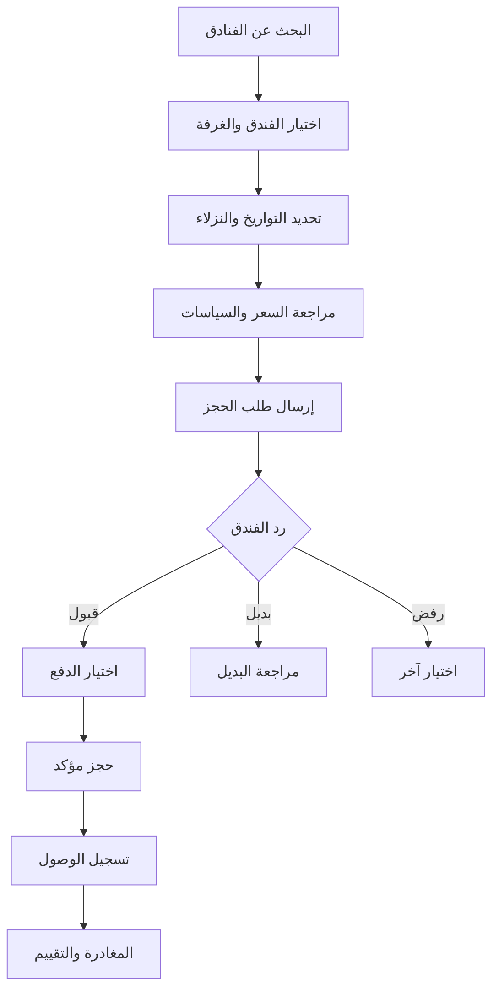
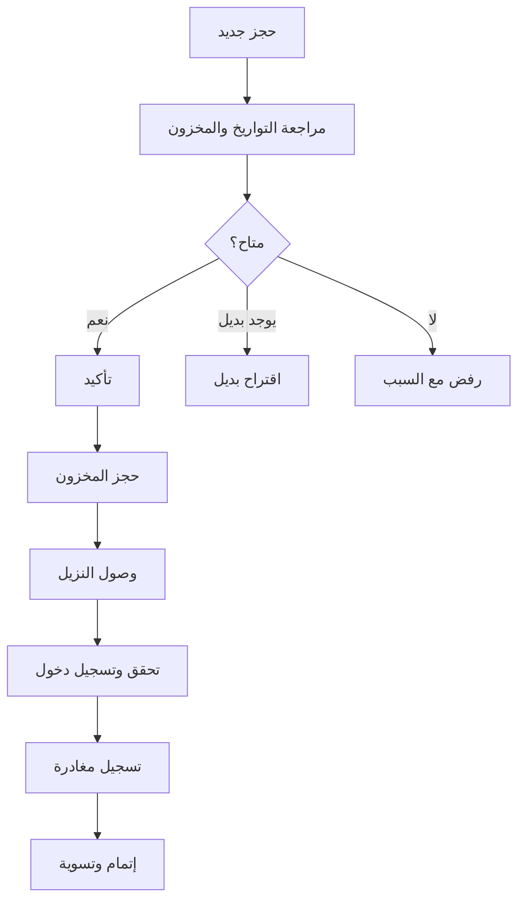
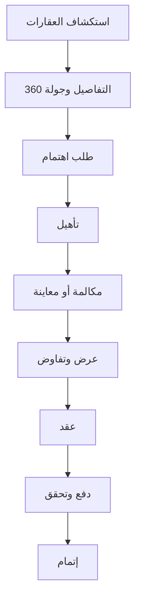
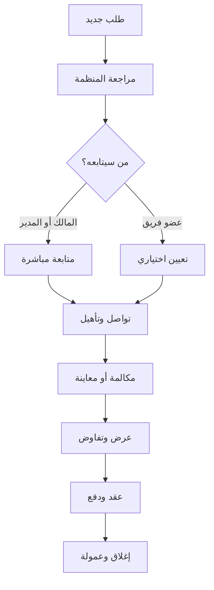

# مسارات المعاملات والحجوزات في ORBIX

> مواصفة المنتج والتنفيذ لنظام المعاملات العقارية، وحجوزات الفنادق، ولوحات الشركاء، وإدارة منصة ORBIX.

**حالة الوثيقة:** مسودة v1.0  
**المرحلة الحالية:** واجهات Flutter ببيانات تجريبية `Mock Data`  
**الخادم الخلفي:** غير مربوط  
**Firebase:** يجب أن يبقى معطلاً في المرحلة الحالية

---

## 1. هدف الوثيقة

تحدد هذه الوثيقة طريقة إدارة ORBIX لما يلي:

- طلبات شراء العقارات واستئجارها.
- المعاينات والتفاوض والعقود والمدفوعات والعمولات.
- توافر غرف الفنادق وطلبات الحجز.
- تأكيد الحجز وتسجيل الوصول والمغادرة والإلغاء والتسويات.
- لوحات العميل والشريك العقاري والفندق وإدارة ORBIX.
- آليات تحقيق الإيرادات وتسجيل عمولة المنصة.

مشروع Flutter الحالي نموذج واجهات تجريبي. الهدف الآن عرض جميع المسارات باستخدام مستودع بيانات تجريبي مشترك داخل التطبيق `Shared Mock Repository`. يستبدل لاحقاً بـAPI وقاعدة بيانات حقيقية دون إعادة بناء الشاشات.

---

## 2. حدود المنتج

توجد طبقة معاملات مشتركة، لكن يبقى منطق العقارات منفصلاً عن منطق الفنادق.

| وظائف مشتركة | وظائف عقارية | وظائف فندقية |
|---|---|---|
| المستخدمون والمنظمات | طلب الاهتمام | أنواع الغرف |
| سجل الحالات | تأهيل العميل | التوافر لكل ليلة |
| الرسائل والإشعارات | موعد المعاينة | الدخول والخروج |
| المدفوعات والعمولات | العرض والعقد | النزلاء والإشغال |
| سجل التدقيق | بيع أو إيجار | الإلغاء والتسجيل |

لا تستخدم قائمة حالات واحدة للنشاطين.

---

## 3. أنواع المستخدمين

### 3.1 العميل

- يتصفح العقارات والفنادق.
- يرسل طلباً عقارياً أو حجزاً فندقياً.
- يحجز معاينة ويتابع حالة طلبه.
- يراسل الجهة المسؤولة.
- يراجع العقد ويرفع إثبات الدفع في المراحل اللاحقة.
- يستلم تأكيد الحجز ورمز التحقق.

### 3.2 الشريك العقاري

قد يكون مكتباً عقارياً أو مطوراً أو مالكاً مباشراً. يستطيع صاحب المكتب التواصل مع العميل بنفسه. تعيين موظف أو وسيط خيار تنظيمي وليس إلزامياً.

### 3.3 شريك الفندق

يدير ملف الفندق والغرف والتوافر والأسعار والحجوزات والنزلاء والمدفوعات وعمولة ORBIX.

### 3.4 إدارة ORBIX

تتحقق من المنظمات والإعلانات، وتراقب المعاملات، وتدير النزاعات، وتتابع العمولات والتسويات.

---

## 4. المنظمة والعضوية

يمثل كل مكتب أو مطور أو فندق كمنظمة:

```text
Organization
├── organizationId
├── type: real_estate_office | developer | hotel | owner
├── name
├── verificationStatus
└── status
```

ويرتبط المستخدم بالمنظمة عبر:

```text
OrganizationMember
├── membershipId
├── organizationId
├── userId
├── role
└── status
```

| المنظمة | الأدوار المقترحة |
|---|---|
| مكتب عقاري | `owner`, `manager`, `sales`, `viewer` |
| مطور | `owner`, `sales_manager`, `sales`, `viewer` |
| فندق | `owner`, `general_manager`, `reservations_manager`, `receptionist`, `accountant`, `viewer` |

تصفى كل بيانات المنظمة باستخدام `organizationId`.

---

## 5. مبادئ المعاملات

1. يبدأ العميل الطلب من إعلان على ORBIX.
2. يعود الطلب إلى المنظمة التي تملك الإعلان أو تديره.
3. يمكن أن يبقى في صندوق المنظمة العام.
4. يستطيع المالك اختيار **سأتولى الطلب بنفسي**.
5. يستطيع اختيارياً تعيين عضو من الفريق.
6. يشاهد العميل والمنظمة الحالة نفسها مع أفعال مناسبة لصلاحية كل طرف.
7. تشاهد إدارة ORBIX المعاملة للرقابة واحتساب العمولة.
8. كل تغيير للحالة ينشئ سجلاً في تاريخ المعاملة.
9. تخزن العملة مع كل قيمة مالية.
10. تستحق العمولة عند تحقق حدث النجاح المتفق عليه فقط.

```text
organizationId      إجباري
assignedToUserId    اختياري
```

لا يستخدم `brokerId` كحقل إجباري. القيمة `assignedToUserId = null` تعني أن الطلب ما زال في صندوق المنظمة.

---

## 6. مسار عميل الفندق



### خطوات العميل

1. يبحث حسب الوجهة والتواريخ وعدد النزلاء.
2. يشاهد الغرف المناسبة للإشغال المطلوب.
3. يفتح تفاصيل الفندق والخدمات والسياسات والغرف.
4. يختار نوع الغرفة والكمية.
5. يراجع سعر الليلة والضرائب والإجمالي وسياسة الإلغاء.
6. يدخل بيانات النزيل والطلبات الإضافية.
7. يرسل الحجز وتظهر الحالة `awaiting_hotel_confirmation`.
8. يقبل البديل أو يرفضه إذا اقترحه الفندق.
9. يستلم رقم الحجز وQR بعد التأكيد.
10. يقدم الرمز عند الوصول ثم يقيّم الإقامة بعد المغادرة.

### حالات الحجز

```text
draft                         مسودة
pending                       قيد الإرسال
awaiting_hotel_confirmation   بانتظار الفندق
alternative_proposed          تم اقتراح بديل
confirmed                     مؤكد
payment_pending               بانتظار الدفع
cancelled_by_guest            ألغاه النزيل
cancelled_by_hotel            ألغاه الفندق
rejected                      مرفوض
checked_in                    تم تسجيل الوصول
checked_out                   تم تسجيل المغادرة
no_show                       لم يحضر النزيل
refund_pending                الاسترداد قيد المعالجة
refunded                      تم الاسترداد
completed                     مكتمل
```

| الحالة | أفعال العميل |
|---|---|
| `draft` | تعديل، إرسال، حذف |
| `awaiting_hotel_confirmation` | مشاهدة، مراسلة، إلغاء وفق السياسة |
| `alternative_proposed` | قبول البديل أو رفضه |
| `confirmed` | مشاهدة التأكيد، دفع، مراسلة، إلغاء وفق السياسة |
| `checked_in` | مشاهدة بيانات الإقامة والتواصل |
| `completed` | التقييم وتنزيل الإيصال |

---

## 7. مسار لوحة الفندق

### أقسام اللوحة

- نظرة عامة.
- صندوق طلبات الحجز.
- الحجوزات.
- تقويم التوافر.
- الغرف وأنواعها.
- النزلاء والرسائل.
- المدفوعات والتسويات.
- التقييمات.
- الفريق والصلاحيات.
- الإعدادات.



### خطوات الفندق

1. يفتح الطلب ويراجع الغرفة والتواريخ والنزلاء والمبلغ.
2. يتحقق من التوافر.
3. يؤكد أو يرفض مع السبب أو يقترح بديلاً.
4. عند التأكيد يحجز الكمية المطلوبة من المخزون.
5. يتواصل مع النزيل.
6. يتحقق من رمز الحجز عند الوصول.
7. يغير الحالة إلى `checked_in` ثم `checked_out`.
8. يراجع إجمالي الحجز وعمولة ORBIX وصافي الفندق.

لا يجوز تأكيد غرف أكثر من المتاح لنوع الغرفة والفترة نفسيهما. في الخادم الحقيقي تنفذ عملية التأكيد كمعاملة قاعدة بيانات ذرية لمنع `Overbooking`.

---

## 8. مسار العميل العقاري



### خطوات العميل

1. يبحث عن عقار للبيع أو الإيجار.
2. يراجع التفاصيل والتحقق والموقع والجولة.
3. يرسل طلب اهتمام.
4. يدخل الميزانية والمدة وطريقة الدفع وطريقة التواصل.
5. يتواصل مع المكتب أو المطور أو المالك.
6. يحجز مكالمة أو معاينة.
7. يقدم عرضاً أو يستلمه ويتابع التفاوض.
8. يراجع العقد وينفذ الدفع والتحقق.
9. يستلم وثائق إتمام المعاملة.

### حالات المعاملة العقارية

```text
new_inquiry          طلب جديد
contacted            تم التواصل
qualified            مؤهل
unqualified          غير مؤهل
viewing_requested    طلب معاينة
viewing_scheduled    حددت المعاينة
viewing_completed    تمت المعاينة
offer_submitted      قدم العرض
negotiating          تفاوض
offer_accepted       قبل العرض
offer_rejected       رفض العرض
contract_pending     العقد قيد التجهيز
contract_ready       العقد جاهز
contract_signed      العقد موقع
payment_pending      بانتظار الدفع
under_review         قيد المراجعة
completed            مكتملة
cancelled            ملغاة
expired              منتهية
```

---

## 9. مسار المكتب أو المطور

### أقسام اللوحة

- نظرة عامة.
- العقارات.
- صندوق الطلبات.
- المعاينات.
- المعاملات.
- الرسائل.
- العقود والوثائق.
- المدفوعات والعمولات.
- الفريق.
- الإعدادات.



### المكتب الصغير أو المالك المباشر

1. يستلم الطلب في الصندوق العام.
2. يختار **سأتولى الطلب بنفسي**.
3. يتواصل مباشرة مع العميل ويؤهله.
4. يحدد مكالمة أو معاينة ويسجل النتيجة.
5. يدير العرض والتفاوض.
6. يجهز العقد ويتمم المعاملة.

### المكتب الكبير أو المطور

يستطيع المدير اختيارياً تعيين موظف، أو نقل المسؤولية، أو إضافة متعاونين، مع إبقاء مسؤول أساسي واحد. التعيين ليس إلزامياً.

---

## 10. مسار إدارة ORBIX

### أقسام اللوحة

- نظرة عامة.
- المنظمات والتحقق.
- مراجعة الإعلانات.
- الحجوزات الفندقية.
- المعاملات العقارية.
- المدفوعات والإثباتات.
- العمولات والتسويات.
- النزاعات والإلغاءات والاستردادات.
- المستخدمون والصلاحيات.
- سجل التدقيق.

### مسؤوليات الإدارة

1. التحقق من هوية الشركاء ووثائقهم.
2. قبول أو رفض الإعلانات والفنادق.
3. مراقبة المعاملات المتعثرة أو المشبوهة.
4. مراجعة إثباتات الدفع عند الحاجة.
5. معالجة النزاعات والاستردادات.
6. احتساب عمولة ORBIX ومتابعتها.
7. تسجيل التسويات وإيقاف المخالفين.

لا تدير ORBIX أعمال الشريك اليومية بدلاً عنه.

---

## 11. نموذج الإيرادات

### العقارات

- حصة من عمولة الشريك للعملاء القادمين عبر ORBIX.
- رسم نجاح ثابت لكل صفقة مكتملة.
- نسبة متفق عليها لمبيعات المطور.

```text
سعر العقار:            100,000 USD
عمولة المكتب:            2,000 USD
حصة ORBIX:         25% من عمولة المكتب
إيراد ORBIX:                500 USD
صافي المكتب:              1,500 USD
```

لا تحتسب عمولة ORBIX من كامل سعر العقار إلا إذا نص الاتفاق على ذلك.

### الفنادق

```text
إجمالي الحجز:         200 USD
عمولة ORBIX:          10%
إيراد ORBIX:           20 USD
صافي الفندق:          180 USD قبل الرسوم الأخرى
```

تستحق العمولة عادة بعد المغادرة أو انتهاء مدة الإلغاء والاسترداد.

### الخدمات المباشرة

- التصوير.
- جولات 360 درجة.
- المخططات الطابقية.
- صفحات العرض.
- الفيديو والمحتوى.
- الحملات التسويقية.
- الظهور المميز.

| الخدمة | التسعير المقترح |
|---|---|
| الإدراج الأساسي | مجاني |
| لوحة الشريك | مجانية |
| استقبال الطلبات | مجاني |
| حجز أو صفقة مكتملة | عمولة أو رسم نجاح |
| التصوير والجولات | مدفوع |
| الظهور المميز | اختياري ومدفوع |

---

## 12. نموذج البيانات

### الجداول المشتركة

```text
users
organizations
organization_members
listings
transactions
payments
commissions
contracts
messages
notifications
status_history
audit_logs
```

### جداول العقارات

```text
properties
property_inquiries
property_transactions
viewing_appointments
property_offers
```

### جداول الفنادق

```text
hotels
room_types
room_inventory
availability
rate_plans
hotel_bookings
booking_guests
```

### حقول المعاملة المشتركة

```text
transactionId
transactionType: property_sale | property_rent | hotel_booking
customerId
organizationId
assignedToUserId: nullable
listingId
status
currency
grossAmount
commissionAmount
netAmount
createdAt
updatedAt
```

### حقول الحجز الفندقي

```text
bookingId
transactionId
hotelId
roomTypeId
checkIn
checkOut
nights
roomsCount
adultsCount
childrenCount
guestDetails
specialRequests
cancellationPolicySnapshot
bookingCode
confirmedAt
checkedInAt
checkedOutAt
```

### حقول المعاملة العقارية

```text
propertyTransactionId
transactionId
propertyId
purpose: sale | rent
qualificationData
viewingAppointmentId
offerAmount
contractId
completionDate
```

---

## 13. مصفوفة الصلاحيات

| الإجراء | العميل | الشريك العقاري | الفندق | إدارة ORBIX |
|---|---:|---:|---:|---:|
| مشاهدة طلباته | نعم | لا | لا | نعم |
| مشاهدة طلبات المنظمة | لا | حسب الصلاحية | حسب الصلاحية | نعم |
| مشاهدة منظمة أخرى | لا | لا | لا | نعم |
| إرسال طلب عقاري | نعم | لا | لا | اختياري |
| إرسال حجز فندقي | نعم | لا | لا | اختياري |
| قبول حجز فندقي | لا | لا | حسب الصلاحية | تدخل استثنائي |
| متابعة طلب عقاري | لا | حسب الصلاحية | لا | رقابة |
| تعيين عضو فريق | لا | مالك أو مدير | مالك أو مدير | نعم |
| تعديل العمولة | لا | لا | لا | نعم |
| التحقق من الشريك | لا | لا | لا | نعم |

لاحقاً تفرض الصلاحيات في الخادم؛ إخفاء الأزرار في الواجهة ليس حماية أمنية.

---

## 14. الإشعارات

ترسل إشعارات عند:

- وصول طلب عقاري أو فندقي.
- تعيين الطلب أو نقله.
- تحديد المعاينة أو تعديلها.
- تأكيد الحجز أو رفضه أو اقتراح بديل.
- جاهزية العقد أو توقيعه.
- طلب الدفع أو رفعه أو قبوله أو رفضه.
- التذكير بتسجيل الوصول.
- تحديث الإلغاء أو الاسترداد.
- إتمام المعاملة.

في مرحلة Mock تعرض الإشعارات داخل الحالة التجريبية فقط، دون Push Notifications.

---

## 15. متطلبات مرحلة Mock الحالية

### الأدوار التجريبية

```text
عميل تجريبي
شريك عقاري تجريبي
فندق تجريبي
إدارة ORBIX التجريبية
```

تميز أداة التبديل بعبارة `DEMO ONLY` ولا تستخدم في الإنتاج.

### مستودع Mock مشترك

يجب ألا تستخدم اللوحات قوائم ثابتة منفصلة. تقرأ جميعها من مستودع واحد وتكتب إليه باستخدام Riverpod.

```text
createHotelBooking()
confirmHotelBooking()
rejectHotelBooking()
proposeBookingAlternative()
checkInBooking()
checkOutBooking()

createPropertyInquiry()
handleInquiryMyself()
assignInquiry()
scheduleViewing()
updatePropertyTransactionStatus()

getCustomerTransactions()
getOrganizationTransactions()
getAdminTransactions()
```

### سيناريو الفندق

1. ينشئ العميل حجزاً.
2. يظهر في صندوق الفندق الصحيح.
3. يؤكده الفندق.
4. يشاهد العميل الحالة `confirmed`.
5. تشاهد الإدارة الإجمالي والعمولة وصافي الفندق.

### السيناريو العقاري

1. يرسل العميل طلب اهتمام.
2. يظهر في صندوق الشريك الصحيح.
3. يختار الشريك **سأتولى الطلب بنفسي**.
4. يحدد معاينة وينقل المعاملة عبر التفاوض والعقد.
5. يشاهد العميل الحالة نفسها.
6. تشاهد الإدارة المعاملة والعمولة المتوقعة.

يمكن أن تعود البيانات إلى حالتها الأولية بعد إعادة التشغيل. لا تهيأ أو تستدعى Firebase أو Firestore أو Storage أو Cloud Functions في هذه المرحلة.

---

## 16. حالات الواجهة المطلوبة

كل شاشة قائمة أو تفاصيل تدعم:

- التحميل.
- عدم وجود بيانات.
- وجود بيانات.
- الخطأ.
- عدم امتلاك الصلاحية.
- تنفيذ الإجراء.
- نجاح الإجراء.
- فشل الإجراء.

---

## 17. الربط المستقبلي

```text
واجهات التطبيق وRiverpod
          ↓
Repository Interfaces
          ↓
Mock Repositories حالياً
          ↓ تستبدل لاحقاً بـ
API Repositories
          ↓
ORBIX Backend + Database
```

يمكن لاحقاً استخدام API مستقل وقاعدة PostgreSQL. لا توضع استدعاءات قاعدة البيانات داخل Widgets.

---

## 18. التدقيق ومنع تجاوز المنصة

يحتاج النظام لاحقاً إلى:

- معرف فريد لكل طلب وحجز.
- تاريخ حالات لا يتغير بصمت.
- سجلات المواعيد والتواصل.
- قبول اتفاقية الشريك.
- تأكيد الإتمام من الأطراف.
- متابعة العميل بعد المعاينة أو الإقامة.
- سجلات المدفوعات والعمولات.
- `Audit Log` للتغييرات الحساسة.

تخلق المنصة قيمة عبر التحقق والتوثيق والدعم، لا عبر إخفاء معلومات التواصل فقط.

---

## 19. مراحل التسليم

### المرحلة الأولى: Mock

- مستودع مشترك.
- Riverpod.
- تبديل الأدوار.
- لوحات العميل والشريك والفندق والإدارة.
- حالات مستقلة للعقارات والفنادق.
- Firebase معطل.

### المرحلة الثانية: تثبيت UX

- حالات التحميل والفراغ والخطأ.
- التصميم المتجاوب وRTL.
- خط زمني للحالات.
- أزرار حسب الصلاحيات.
- اختبارات انتقال الحالات.

### المرحلة الثالثة: الخادم والمصادقة

- عقد API وتسجيل الدخول.
- المنظمات والعضويات.
- صلاحيات الخادم.
- قاعدة البيانات والترحيلات.
- سجل التدقيق.

### المرحلة الرابعة: التشغيل

- المدفوعات وإثباتاتها.
- العقود والمستندات.
- الرسائل والإشعارات.
- تسوية العمولات.
- حماية مخزون الفنادق وقواعد الإلغاء.

---

## 20. معايير قبول مرحلة Mock

- [ ] يعمل التطبيق دون إعداد Firebase.
- [ ] لا تستدعى خدمات Firebase عند التشغيل أو فتح الشاشات.
- [ ] تتوفر الأدوار التجريبية الأربعة.
- [ ] يظهر حجز العميل في الفندق الصحيح.
- [ ] يظهر تأكيد الفندق لدى العميل.
- [ ] تظهر أرقام الحجز المالية لدى الإدارة.
- [ ] يظهر طلب العقار في الشريك الصحيح.
- [ ] يستطيع الشريك متابعة الطلب بنفسه دون وسيط.
- [ ] التعيين اختياري.
- [ ] تظهر تحديثات العقار لدى العميل والإدارة.
- [ ] حالات الفنادق والعقارات منفصلة.
- [ ] تصفى البيانات باستخدام `organizationId`.
- [ ] تستخدم Riverpod للحالة المشتركة.
- [ ] ينجح `flutter analyze` دون مشاكل.
- [ ] توجد اختبارات لانتقالات الحالات.
- [ ] يحافظ التنفيذ على التصميم الحالي.

---

## 21. تعليمات للمطور

1. اقرأ الوثيقة وافحص المشروع قبل التعديل.
2. حافظ على الهوية البصرية والتنقل الحاليين.
3. نفذ Mock فقط ما لم يطلب Backend صراحة.
4. لا تهيئ Firebase ولا تحذف ملفات خدماته الحالية.
5. استخدم Repository Abstractions وRiverpod.
6. لا تجعل تعيين موظف إلزامياً.
7. أبقِ `assignedToUserId` قابلاً لـ`null`.
8. افصل حالات الفنادق عن العقارات.
9. خزّن أساس العمولة ونسبتها أو رسمها ومبلغها وعملتها.
10. نفذ التنسيق والتحليل والاختبارات.
11. قدم تقريراً بالملفات المعدلة والمسارات والاختبارات والنواقص.

---

## 22. خارج نطاق المرحلة الحالية

- المصادقة الإنتاجية.
- المدفوعات الحقيقية.
- مزامنة مخزون الفنادق الحقيقية.
- إعداد Firebase.
- قاعدة بيانات إنتاجية.
- Push Notifications.
- توقيع العقود.
- الاستردادات الآلية.
- القواعد الضريبية والقانونية.
- النشر الإنتاجي.

تحتاج هذه العناصر إلى مواصفات وموافقة مستقلة.
1. Google Drive = مستودع العقود والوثائق
كل معاملة ممكن يكون إلها Folder أو مستندات مرتبطة:
ORBIX TRANSACTIONS
│
├── ORB-1001
│   ├── Contract.pdf
│   ├── Signed-Contract.pdf
│   └── Supporting-Documents
│
├── ORB-1002
│   └── ...
Orbix ما يحتاج يبني Document Management System كامل.
داخل صفحة المعاملة فقط:
العقد
 Signed
[فتح في Google Drive]

2. Google Docs = Templates
نحضر مسبقًا:
قالب عقد إيجار
قالب اتفاق بيع
قالب حجز
قالب اتفاق عمولة
قالب شراكة مكتب
مثلاً Template:
عقد إيجار

المؤجر: {{landlord_name}}
المستأجر: {{customer_name}}

العقار: {{property_address}}

القيمة: {{amount}}
العملة: {{currency}}

المدة: {{duration}}
تاريخ البداية: {{start_date}}

رقم معاملة Orbix:
{{transaction_id}}
بمرحلة MVP ممكن الموظف يعمل نسخة من القالب ويعبّيها.
وبعدين لما يثبت النظام، منعمل Automation.

3. Gmail = إرسال العقد
بعد تجهيز العقد، العميل يستلم بريد رسمي مثل:
From:
transactions@orbixcity.com

Subject:
عقد معاملتك العقارية ORB-10582
وفي الرسالة:
مرحباً أحمد،

تم إعداد مستند معاملتك العقارية.

العقار:
شقة في الوعر — حمص

رقم المعاملة:
ORB-10582

المبلغ:
5,000 USD

يمكنك مراجعة العقد المرفق.

تعليمات الدفع موجودة ضمن المستند.

Orbix
ومرفق PDF.

4. داخل العقد نحط Payment Instructions
وهون بتدخل الفكرة اللي حكينا عنها:
─────────────────────────────
تعليمات الدفع
─────────────────────────────

المبلغ:
5,000 USD

المستفيد:
Atlas Real Estate

البنك:
XXXX Bank

رقم الحساب:
XXXXXXXXXXXX

مرجع الدفع:
ORB-10582

       [ QR CODE ]

يرجى استخدام رقم المعاملة
ORB-10582
كمرجع عند الدفع.
العميل يحول للطرف المستحق مباشرة.
Orbix ما يحتفظ بالمبلغ.

5. صاحب المكتب شو بيعمل؟
بعد استلام الحوالة، ما بده محاسبة معقدة.
يفتح:
المعاملات → ORB-10582
ويلاقي:
الدفع

5,000 USD

المستفيد
Atlas Real Estate

الحالة
بانتظار تأكيد الاستلام

[ تأكيد استلام المبلغ ]
يضغط الزر.
تصير:
✓ تم تأكيد استلام المبلغ بواسطة Atlas Real Estate
مع Date + User.

6. بعدها تنحسب عمولة Orbix
هون شغلة مهمة نخليها داخل النظام، مو Google.
مثلاً اتفاقنا مع Atlas:
Orbix = 20% من عمولة المكتب.
المعاملة خلصت.
النظام يعرف:
قيمة المعاملة        $50,000

عمولة المكتب          $1,000

حصة Orbix 20%           $200
ويولد:
Orbix Fee

Transaction:
ORB-10582

Partner:
Atlas Real Estate

Amount Due:
$200

Status:
Unpaid
وبعدين المكتب يحول الـ200$ لـRIVIA/Orbix.

7. ممكن Google يساعد حتى هون
بالنسخة الأولى، ما في داعي نبني Billing System ضخم.
ممكن نرسل للمكتب Gmail:
عمولة Orbix — ORB-10582

المبلغ المستحق:
200 USD

مرجع الدفع:
ORB-FEE-10582

بيانات الحساب:
RIVIA / Orbix
XXXXXX

[QR]

وبعد وصول الحوالة، فريقنا يضغط:
Mark Fee as Paid
خلص.
لنتيجة

...
فلسفة
               ORBIX

Marketplace
     ↓
Requests
     ↓
Transactions
     ↓
┌───────────────┬──────────────┐
│               │              │
Google         Direct        Orbix
Contracts      Payment       Fee
& Documents    to Partner    Tracking
وهذا أخف بكثير.
والأهم: لا نعمل Integration مع Google APIs كله من أول يوم.
نعمل 3 مراحل:
المرحلة 1 — Manual Assisted: Orbix فيه أزرار مثل فتح قالب العقد وفتح Drive، والفريق يكمل العملية على Google يدويًا.
المرحلة 2 — Semi-Automated: Orbix ينشئ اسم المعاملة، البيانات والروابط، ونبدأ أتمتة إنشاء المستندات والإيميلات.
المرحلة 3 — Integrated: Google APIs / Apps Script أو backend ينشئ نسخة العقد، يملأ البيانات، يحفظها بالـDrive، يرسلها، ويرجع حالة المستند إلى Orbix.
وبهيك ما منضيع شهرين على Google Integration قبل ما نعرف إذا المكتب أصلًا رح يغلق معاملات عن طريق Orbix.


